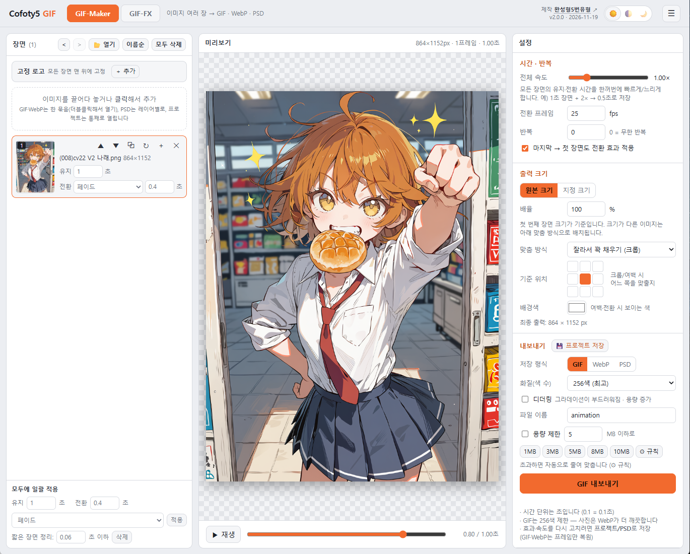
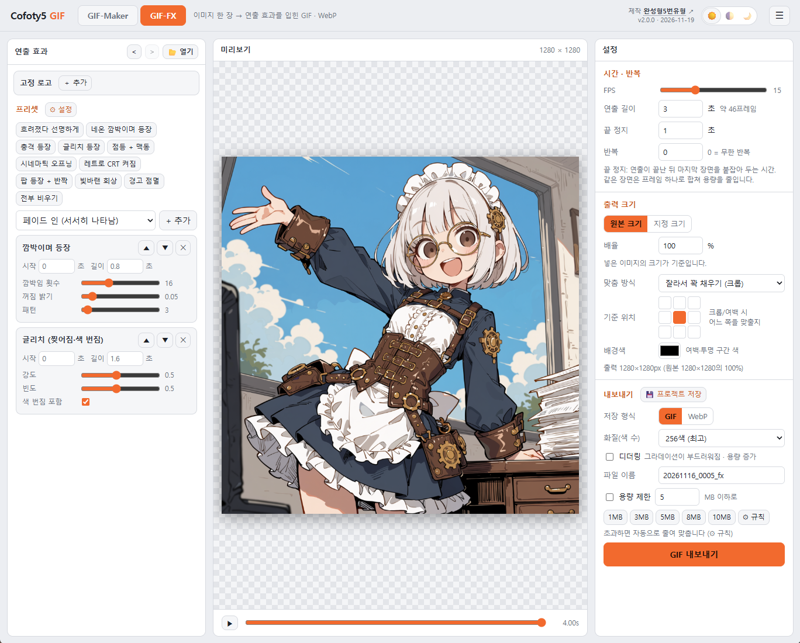

# Cofoty5 GIF-Maker / GIF-FX

[한국어](README.md) · **English** · [日本語](README.ja.md) · [简体中文](README.zh-CN.md) · [繁體中文](README.zh-TW.md)

GIF tools that run right in your browser. Nothing to install, and your images never leave your computer.

### ▶ [Open the app](https://cofoty5.github.io/cofoty5-gif/?lang=en)  ·  ⬇ [Download](https://github.com/CoFoTy5/cofoty5-gif/releases/latest/download/Cofoty5-GIF.html)

- **GIF-Maker**: multiple images → GIF · WebP · PSD
- **GIF-FX**: one image + effects → GIF · WebP

Both tools live in one page as two tabs and don't affect each other. The downloaded HTML file works offline — just double-click it. Use the **☰ menu** at the top right to switch language (한국어 · English · 日本語 · 简体中文 · 繁體中文) or download the HTML.

---

## 🖼 GIF-Maker

**How to use**

1. Drag images (or GIF · WebP · PSD) into the left panel.
2. Set the hold time and transition for each scene.
3. Set size · logo · size limit on the right, then **Export** → **Download**.

**Features**

- 20 transitions, overall playback speed, fixed logo
- Output size: original (scale) or custom, with fit mode and anchor
- Formats: GIF / WebP / layered PSD, with a size limit that shrinks the file automatically
- **GIF/WebP clips**: each file becomes one card. **Double-click** to expand its frames — delete, reorder, retime or add frames, and drag frames in or out of the clip.
- **Undo**: `<` `>` buttons or `Ctrl+Z` / `Ctrl+Shift+Z`
- 💾 **Save project** to keep editing later

---

## 🎬 GIF-FX

**How to use**

1. Add an image, then pick a preset or stack effects with "+ Add".
2. Set size · FPS · length · loop on the right.
3. **Export** → **Download**. Use "→ Send to GIF-Maker" to keep editing there.

**Features**

- Stack any of 35 effects (entrance · exit · loop · screen), each with its own start, length and easing
- 10 built-in presets + your own presets (⚙ Settings), custom effects in code
- GIF / WebP, size limit, fixed logo
- **Undo**: `<` `>` buttons or `Ctrl+Z` / `Ctrl+Shift+Z`
- 💾 **Save project** to keep editing later

---

<b>📌 Notes (click to expand)</b>

- **Chrome or Edge recommended**: opening GIF/WebP and saving WebP work in these browsers. GIF-FX also works in Firefox; in Safari, blur · grayscale · brightness effects don't render.
- GIF supports only 256 colors and no semi-transparency, so photos look cleaner as WebP.
- Undo covers scene-list edits in GIF-Maker and effects/settings in GIF-FX.
- Transitions apply between clips, not between frames inside a clip.
- Only 8-bit RGB PSDs can be opened.
- Presets and custom effects are stored in this browser; back them up with "Export".
- Add `?lang=en` (ko · en · ja · zh · tw) to the URL to open in that language.
- GIF encoding uses [gifenc](https://github.com/mattdesl/gifenc) (MIT License, © Matt DesLauriers).

---

**[Cofoty5](https://cft5.pages.dev/)** · v2.0.0 · 2026-11-19
