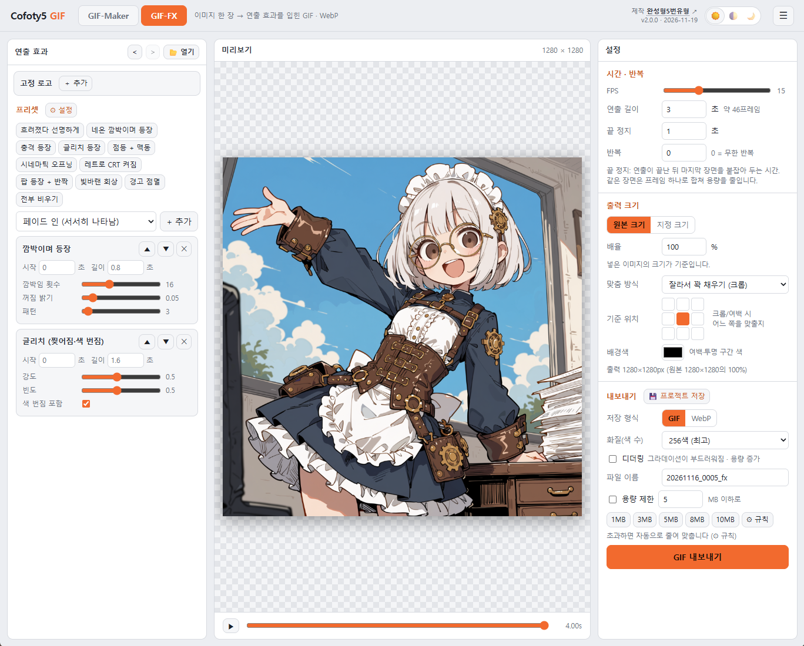

# Cofoty5 GIF-Maker / GIF-FX

[한국어](README.md) · [English](README.en.md) · **日本語** · [简体中文](README.zh-CN.md) · [繁體中文](README.zh-TW.md)

ブラウザですぐ使えるGIF作成ツールです。インストール不要で、画像がパソコンの外に送られることはありません。

### ▶ [すぐ使う](https://cofoty5.github.io/cofoty5-gif/?lang=ja)  ·  ⬇ [ダウンロード](https://github.com/CoFoTy5/cofoty5-gif/releases/latest/download/Cofoty5-GIF.html)

- **GIF-Maker**: 複数の画像 → GIF・WebP・PSD
- **GIF-FX**: 画像1枚 + 演出効果 → GIF・WebP

1つのページに2つのタブとして入っていて、互いに影響しません。ダウンロードしたHTMLファイルはダブルクリックするだけでオフラインでも動きます。右上の **☰ メニュー** で言語(한국어・English・日本語・简体中文・繁體中文)の切り替えとHTMLのダウンロードができます。

---

## 🖼 GIF-Maker

**使い方**

1. 画像(またはGIF・WebP・PSD)を左側にドラッグします。
2. シーンごとに表示時間とトランジションを設定します。
3. 右側でサイズ・ロゴ・容量制限を決めて **書き出し** → **ダウンロード**。

**できること**

- トランジション20種、全体の再生速度、固定ロゴ
- 出力サイズ: 元のサイズ(倍率)またはサイズ指定、フィット方法・基準位置
- 保存形式: GIF / WebP / レイヤーPSD、容量制限(自動で縮小)
- **GIF・WebPクリップ**: ファイル1つがカード1枚になります。**ダブルクリック**で中のフレームが開き、削除・並べ替え・時間変更・追加ができ、ドラッグでクリップの外へ出したり中へ入れたりできます。
- **元に戻す**: `<` `>` ボタン または `Ctrl+Z` / `Ctrl+Shift+Z`
- 💾 **プロジェクト保存** で後から続きを編集

---

## 🎬 GIF-FX

**使い方**

1. 画像を入れ、プリセットを選ぶか「+ 追加」でエフェクトを重ねます。
2. 右側でサイズ・FPS・長さ・ループを設定します。
3. **書き出し** → **ダウンロード**。「→ GIF-Makerへ送る」で続けて編集もできます。

**できること**

- 35種のエフェクト(登場・退場・繰り返し・画面効果)を重ね、それぞれ開始・長さ・速度感を調整
- 標準プリセット10種 + 自作プリセットの保存・管理(⚙ 設定)、コードでエフェクトを追加
- GIF / WebP、容量制限、固定ロゴ
- **元に戻す**: `<` `>` ボタン または `Ctrl+Z` / `Ctrl+Shift+Z`
- 💾 **プロジェクト保存** で後から続きを編集

---

<b>📌 注意事項(クリックで展開)</b>

- **Chrome・Edge推奨**: GIF・WebPの読み込みとWebP保存はこの2つのブラウザで動作します。GIF-FXはFirefoxでも使えますが、Safariではぼかし・モノクロ・明るさの効果が出ません。
- GIFは256色までで半透明に対応しないため、写真はWebPの方がきれいです。
- 元に戻すの対象は、GIF-Makerではシーン一覧の編集、GIF-FXではエフェクト・設定の変更です。
- トランジションはクリップ同士の間にかかり、クリップ内のフレーム間にはかかりません。
- PSDは8ビットRGBのみ開けます。
- プリセットと自作エフェクトはこのブラウザに保存されます。「書き出し」でバックアップしてください。
- URLの末尾に `?lang=ja`(ko・en・ja・zh・tw)を付けるとその言語で開きます。
- GIFエンコードに [gifenc](https://github.com/mattdesl/gifenc)(MIT License, © Matt DesLauriers)を使用しています。

---

**[Cofoty5](https://cft5.pages.dev/)** · v2.0.0 · 2026-11-19
