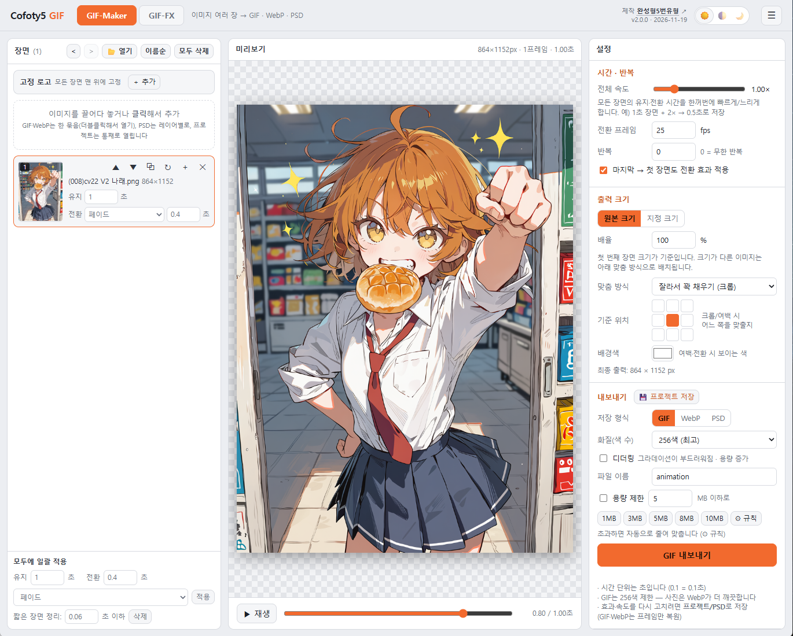
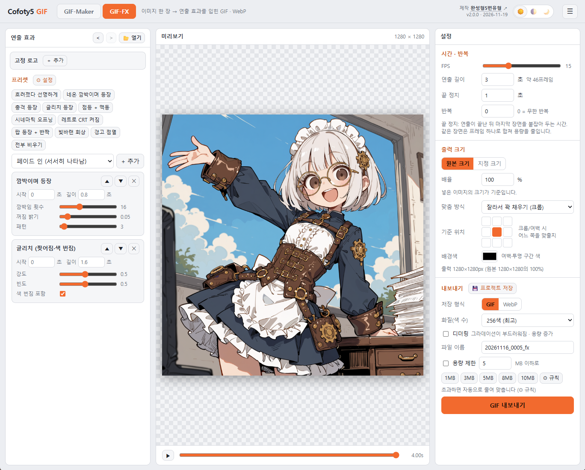

# Cofoty5 GIF-Maker / GIF-FX

브라우저에서 바로 쓰는 GIF 제작 도구입니다. 설치가 필요 없고, 이미지는 내 컴퓨터 밖으로 나가지 않습니다.

| 도구 | 하는 일 | 사용 |
| --- | --- | --- |
| **GIF-Maker** | 이미지 **여러 장** → GIF · WebP · PSD | [열기](https://cofoty5.github.io/cofoty5-gif/) |
| **GIF-FX** | 이미지 **한 장** + 연출 효과 → GIF · WebP | [열기](https://cofoty5.github.io/cofoty5-gif/#fx) |

두 도구는 한 페이지의 탭이고, 서로 영향을 주지 않습니다.

---

## 🖼 GIF-Maker

**이렇게 씁니다**

1. 이미지(또는 GIF·WebP·PSD)를 왼쪽에 끌어다 놓습니다.
2. 장면마다 유지 시간과 전환 효과를 정합니다.
3. 오른쪽에서 크기·로고·용량 제한을 정하고 **내보내기** → **다운로드**.

**할 수 있는 것**

- 전환 효과 20종, 전체 재생 속도, 고정 로고
- 출력 크기: 원본(배율) 또는 지정 크기, 맞춤 방식·기준 위치 선택
- 저장 형식: GIF / WebP / 레이어 PSD, 용량 제한(자동으로 줄여 맞춤)
- **GIF·WebP 묶음**: 파일 하나가 카드 한 장이 됩니다. **더블클릭**하면 안의 프레임이 펼쳐져 삭제·순서·시간·추가를 할 수 있고, 끌어서 묶음 밖으로 꺼내거나 안으로 넣을 수 있습니다.
- **되돌리기**: `<` `>` 버튼 또는 `Ctrl+Z` / `Ctrl+Shift+Z`
- 💾 **프로젝트 저장**으로 나중에 이어서 편집

---

## 🎬 GIF-FX

**이렇게 씁니다**

1. 이미지를 넣고 프리셋을 고르거나 「+ 추가」로 효과를 쌓습니다.
2. 오른쪽에서 크기·FPS·길이·반복을 정합니다.
3. **내보내기** → **다운로드**. 「→ GIF-Maker로 보내기」로 이어서 편집도 됩니다.

**할 수 있는 것**

- 효과 35종(등장·퇴장·반복·화면 효과)을 여러 개 쌓고, 효과마다 시작·길이·속도감 조절
- 기본 프리셋 10종 + 내 프리셋 저장·관리(⚙ 설정), 효과 직접 추가(코드)
- 저장 형식 GIF / WebP, 용량 제한, 고정 로고
- **되돌리기**: `<` `>` 버튼 또는 `Ctrl+Z` / `Ctrl+Shift+Z`
- 💾 **프로젝트 저장**으로 나중에 이어서 편집

---

<b>📌 수정 내역 · 알아둘 점 (펼치기)</b>

### 최근 업데이트 (GIF-Maker v1.7.1 · GIF-FX v1.5.1 · 2026-11-19)

- 이름을 **Cofoty5 GIF-Maker / GIF-FX**로 변경(Cofoty5 시리즈)
- 묶음을 더블클릭해 열고, 프레임 편집·상하위 이동(끌기, ↰ ↴ 버튼) 가능. ⤢ 풀기는 확인 경고가 뜹니다.
- GIF-Maker·GIF-FX 모두 되돌리기 / 다시 실행 추가
- 숫자 칸에 클릭용 화살표(▲▼) 추가, 숫자 정렬·단위 표기 통일
- 용량 제한 「⚙ 규칙」: 자동(권장) / 순서대로
- GIF-Maker·GIF-FX를 한 페이지의 탭으로 통합

### 알아둘 점

- **크롬·엣지 권장**: GIF·WebP 불러오기와 WebP 저장은 이 두 브라우저에서 됩니다. GIF-FX는 파이어폭스도 되지만 사파리에서는 블러·흑백·밝기 효과가 나오지 않습니다.
- GIF는 256색·반투명 미지원이라 사진은 WebP가 더 깨끗합니다. 투명해지는 구간에는 배경색이 보입니다.
- 되돌리기: GIF-Maker는 장면 목록 편집만(크기·로고 같은 설정은 제외), GIF-FX는 효과·설정 변경(이미지 교체는 제외)이 대상입니다.
- 묶음 안의 프레임에는 전환 효과가 걸리지 않고, 묶음과 묶음 사이에만 걸립니다. 묶음 안에 다른 묶음을 넣을 수는 없습니다.
- 프레임을 편집한 묶음은 프로젝트 파일에 프레임 목록으로 저장되어 파일이 더 커집니다.
- PSD는 8비트 RGB만 불러올 수 있습니다.
- 프리셋·직접 추가한 효과는 이 브라우저에 저장됩니다. 캐시를 지우면 사라지니 「내보내기」로 백업하세요.
- 프로젝트 확장자: GIF-Maker `.umzzal.json`(예전 파일과의 호환 유지), GIF-FX `.gifx.json`

### 올릴 파일

- `index.html` — 두 도구가 들어 있는 단일 파일(이것 하나로 동작)
- `README.md`, `gif-maker.png`, `gif-fx.png` — 저장소 루트에 둡니다.

### 라이선스

GIF 인코딩에 [gifenc](https://github.com/mattdesl/gifenc)(MIT License, © Matt DesLauriers)를 사용했습니다.

---

**[완성형5번유형](https://cft5.pages.dev/)** · GIF-Maker v1.7.1 · GIF-FX v1.5.1 · 최종 업데이트 2026-11-19
