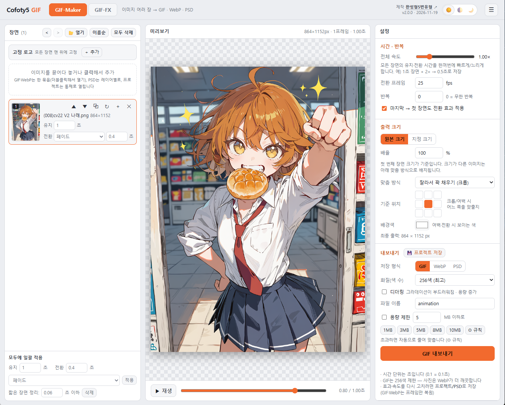
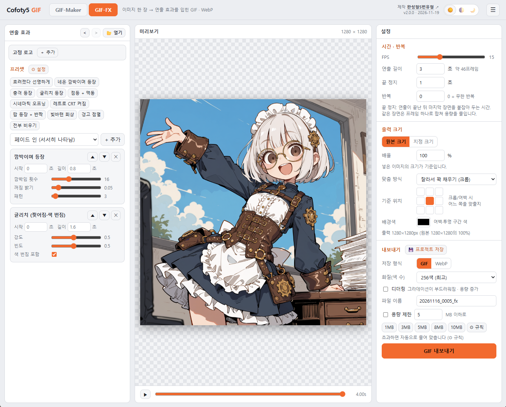

# Cofoty5 GIF-Maker / GIF-FX

[한국어](README.md) · [English](README.en.md) · [日本語](README.ja.md) · **简体中文** · [繁體中文](README.zh-TW.md)

在浏览器中直接使用的 GIF 制作工具。无需安装，图片不会离开你的电脑。

### ▶ [立即使用](https://cofoty5.github.io/cofoty5-gif/?lang=zh)  ·  ⬇ [下载](https://github.com/CoFoTy5/cofoty5-gif/releases/latest/download/Cofoty5-GIF.html)

- **GIF-Maker**:多张图片 → GIF · WebP · PSD
- **GIF-FX**:一张图片 + 特效 → GIF · WebP

两个工具以两个标签页放在同一个页面中，互不影响。下载的 HTML 文件双击即可离线运行。可在右上角 **☰ 菜单** 中切换语言(한국어 · English · 日本語 · 简体中文 · 繁體中文)并下载 HTML。

---

## 🖼 GIF-Maker

**使用方法**

1. 把图片(或 GIF · WebP · PSD)拖到左侧。
2. 为每个场景设置停留时间和转场效果。
3. 在右侧设置尺寸 · 标志 · 大小限制，然后 **导出** → **下载**。

**功能**

- 20 种转场、整体播放速度、固定标志
- 输出尺寸：原始尺寸(缩放)或指定尺寸，可选适配方式和对齐位置
- 保存格式：GIF / WebP / 分层 PSD，支持大小限制(自动压缩)
- **GIF·WebP 片段**:一个文件就是一张卡片。**双击** 展开其中的帧，可删除、排序、改时长、添加，还能拖动帧移出或放入片段。
- **撤销**:`<` `>` 按钮 或 `Ctrl+Z` / `Ctrl+Shift+Z`
- 💾 **保存项目**,以后继续编辑

---

## 🎬 GIF-FX

**使用方法**

1. 放入图片，选择预设或用「+ 添加」叠加效果。
2. 在右侧设置尺寸 · FPS · 时长 · 循环。
3. **导出** → **下载**。也可以用「→ 发送到 GIF-Maker」继续编辑。

**功能**

- 35 种效果(出场 · 退场 · 循环 · 画面效果)可叠加，每个效果单独调整开始、时长和节奏
- 10 个内置预设 + 自建预设保存与管理(⚙ 设置),可用代码添加自定义效果
- GIF / WebP、大小限制、固定标志
- **撤销**:`<` `>` 按钮 或 `Ctrl+Z` / `Ctrl+Shift+Z`
- 💾 **保存项目**,以后继续编辑

---

<b>📌 注意事项(点击展开)</b>

- **推荐 Chrome · Edge**:打开 GIF·WebP 和保存 WebP 需要这两个浏览器。GIF-FX 也可在 Firefox 使用;Safari 中模糊 · 黑白 · 亮度效果不会显示。
- GIF 最多 256 色且不支持半透明，照片用 WebP 更清晰。
- 撤销范围：GIF-Maker 为场景列表的编辑，GIF-FX 为效果和设置的修改。
- 转场作用于片段之间，不作用于片段内部的帧之间。
- PSD 仅支持 8 位 RGB。
- 预设和自定义效果保存在此浏览器中，请用「导出」备份。
- 在网址后加上 `?lang=zh`(ko · en · ja · zh · tw)即可用该语言打开。
- GIF 编码使用了 [gifenc](https://github.com/mattdesl/gifenc)(MIT License, © Matt DesLauriers)。

---

**[Cofoty5](https://cft5.pages.dev/)** · v2.0.0 · 2026-11-19
