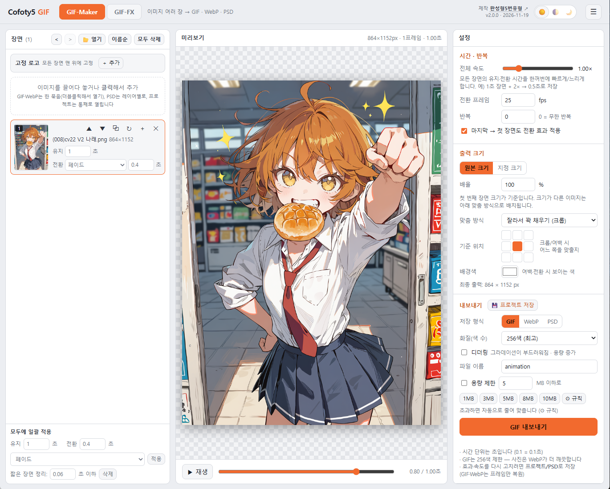
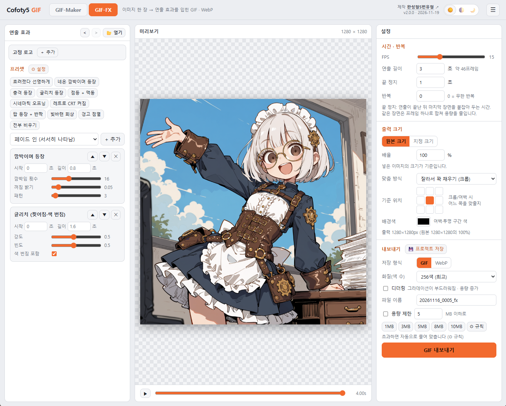

# Cofoty5 GIF-Maker / GIF-FX

[한국어](README.md) · [English](README.en.md) · [日本語](README.ja.md) · [简体中文](README.zh-CN.md) · **繁體中文**

在瀏覽器中直接使用的 GIF 製作工具。無需安裝，圖片不會離開你的電腦。

### ▶ [立即使用](https://cofoty5.github.io/cofoty5-gif/?lang=tw)  ·  ⬇ [下載](https://github.com/CoFoTy5/cofoty5-gif/releases/latest/download/Cofoty5-GIF.html)

- **GIF-Maker**:多張圖片 → GIF · WebP · PSD
- **GIF-FX**:一張圖片 + 特效 → GIF · WebP

兩個工具以兩個標籤頁放在同一個頁面中，互不影響。下載的 HTML 檔案雙擊即可離線執行。可在右上角 **☰ 選單** 中切換語言(한국어 · English · 日本語 · 簡體中文 · 繁體中文)並下載 HTML。

---

## 🖼 GIF-Maker

**使用方法**

1. 把圖片(或 GIF · WebP · PSD)拖到左側。
2. 為每個場景設定停留時間和轉場效果。
3. 在右側設定尺寸 · 標誌 · 大小限制，然後 **匯出** → **下載**。

**功能**

- 20 種轉場、整體播放速度、固定標誌
- 輸出尺寸：原始尺寸(縮放)或指定尺寸，可選適配方式和對齊位置
- 儲存格式：GIF / WebP / 分層 PSD,支援大小限制(自動壓縮)
- **GIF·WebP 片段**:一個檔案就是一張卡片。**雙擊** 展開其中的幀，可刪除、排序、改時長、新增，還能拖動幀移出或放入片段。
- **復原**:`<` `>` 按鈕 或 `Ctrl+Z` / `Ctrl+Shift+Z`
- 💾 **儲存專案**,以後繼續編輯

---

## 🎬 GIF-FX

**使用方法**

1. 放入圖片，選擇預設或用「+ 新增」疊加效果。
2. 在右側設定尺寸 · FPS · 時長 · 迴圈。
3. **匯出** → **下載**。也可以用「→ 傳送到 GIF-Maker」繼續編輯。

**功能**

- 35 種效果(出場 · 退場 · 迴圈 · 畫面效果)可疊加，每個效果單獨調整開始、時長和節奏
- 10 個內建預設 + 自建預設儲存與管理(⚙ 設定),可用程式碼新增自定義效果
- GIF / WebP、大小限制、固定標誌
- **復原**:`<` `>` 按鈕 或 `Ctrl+Z` / `Ctrl+Shift+Z`
- 💾 **儲存專案**,以後繼續編輯

---

<b>📌 注意事項(點選展開)</b>

- **推薦 Chrome · Edge**:開啟 GIF·WebP 和儲存 WebP 需要這兩個瀏覽器。GIF-FX 也可在 Firefox 使用;Safari 中模糊 · 黑白 · 亮度效果不會顯示。
- GIF 最多 256 色且不支援半透明，照片用 WebP 更清晰。
- 復原範圍：GIF-Maker 為場景列表的編輯，GIF-FX 為效果和設定的修改。
- 轉場作用於片段之間，不作用於片段內部的幀之間。
- PSD 僅支援 8 位 RGB。
- 預設和自定義效果儲存在此瀏覽器中，請用「匯出」備份。
- 在網址後加上 `?lang=tw`(ko · en · ja · zh · tw)即可用該語言開啟。
- GIF 編碼使用了 [gifenc](https://github.com/mattdesl/gifenc)(MIT License, © Matt DesLauriers)。

---

**[Cofoty5](https://cft5.pages.dev/)** · v2.0.0 · 2026-11-19
